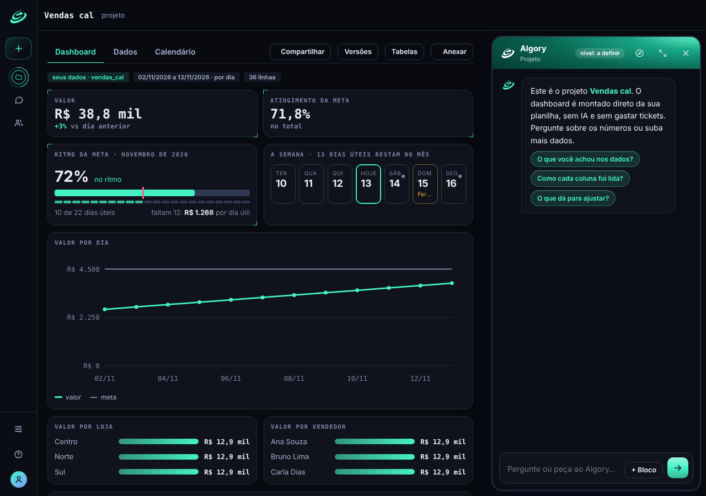

# Algory

Analista de dados com IA para pequenas e médias empresas. Você sobe uma planilha, o Algory lê, monta o dashboard e responde perguntas em português.

**No ar:** [algory.osmio.tech](https://algory.osmio.tech) · **Autor:** Morigan Ventrici · **Ideia original:** Matheus Ventrici

## Por onde começar

| | Página | O que tem |
|---|---|---|
| 1 | **Apresentação** | Esta página |
| 2 | [Como usar](docs/uso.md) | A ferramenta inteira, tela por tela, da mais importante para a menos |
| 3 | [Como a LLM trabalha](docs/como-a-llm-trabalha.md) | O caminho de uma pergunta, o tratamento dos dados e como gasto menos tickets |
| 4 | [Segurança da LLM](docs/seguranca.md) | Injeção de prompt, máscara de dados, o que testei e o que corrigi |
| 5 | [Tecnologias](docs/tecnologias.md) | O que usei e por quê |
| 6 | [Estudo de caso](docs/estudo-de-caso.md) | Como o projeto foi feito, o que aprendi e onde mais dá para aplicar |
| 7 | [Para quem vai testar](docs/testers.md) | Onde colocar o código de teste e com quem falar |
| 8 | [Trechos de código](docs/trechos-de-codigo.md) | As decisões mais importantes, como estão em produção |
| 9 | [Documentação técnica](docs/tecnico/) | Arquitetura, métricas e gabarito, conector de banco, memória da conversa, beta e chamados de ajuda, modo sem IA, como a árvore trabalha, cópia de segurança, calendário, CEP, códigos, integrações, o assistente em cada tela |

## Por que o código não está aqui

> **O código-fonte completo do Algory não é público, por segurança.** O sistema está no ar, com contas de usuários, dados de empresas e pagamento ligado. Publicar o código entregaria a quem quisesse atacar o mapa das defesas: as regras contra injeção de prompt, os limites e as checagens de arquivo.
>
> O que está aqui é a documentação completa e os [trechos de código](docs/trechos-de-codigo.md) das decisões mais importantes. Se você avalia o projeto e precisa ver mais, me escreva: mostro em conversa.

## O que é

O Algory nasceu de uma ideia do Matheus Ventrici: um assistente que lê a planilha de uma pequena empresa e responde o que o dono quer saber, sem ele precisar entender de dados. Eu tirei a ideia do papel.

Três decisões definem o projeto:

1. **O dashboard não usa IA.** Ele é montado por regra, direto dos dados. Abre na hora, não custa nada e não inventa número.
2. **A IA nunca escreve um número.** Ela escreve um marcador, e o servidor coloca o valor que veio da consulta. Se o texto traz número sem origem, é refeito ou barrado.
3. **Dado pessoal sai antes de gravar.** Nome, CPF, e-mail e endereço são tirados na carga da planilha. Telefone vira estado, CEP vira cidade, nome de vendedor vira um código.

## Objetivo do projeto

Este é um projeto de estudo. Eu queria três coisas:

- **Testar ferramentas de desenvolvimento com IA** num projeto de verdade, com usuário, pagamento e servidor, e não num exemplo.
- **Estruturar uma LLM por API:** escolher modelo por tarefa, controlar custo, tratar falha de provedor, proteger os dados.
- **Montar e estudar o comportamento de um chatbot:** o que ele acerta, onde ele inventa, como alguém tenta enganá-lo e o que segura.

O que aprendi está no [estudo de caso](docs/estudo-de-caso.md).

## O que funciona hoje

| Área | O que faz |
|---|---|
| Planilhas | CSV, XLSX e foto de tabela (leitura de texto em português, inglês e espanhol). Acha as tabelas dentro de uma planilha bagunçada e pergunta o que não entendeu. |
| Dashboard | Indicadores, evolução no tempo, rankings, prazos em dias úteis, ritmo da meta. Tudo sem IA. |
| Perguntas | Em português. As diretas ("faturamento em outubro", "qual loja vendeu mais") saem por regra, sem IA. As outras, com a consulta gerada, conferida e limitada ao seu projeto. |
| Conversa com memória | "E por produto?", "e em setembro?", "compare com o mês anterior". A memória fica no navegador; o servidor não guarda a conversa. |
| Investigação | "Por que as vendas caíram?" compara períodos iguais e mostra onde a mudança aconteceu. Sem IA, com teto de consultas. |
| Calendário | Jornada, feriados nacionais e estaduais, folgas e escalas. Entra nos prazos e na meta. |
| Google Planilhas | Por link publicado, com botão de atualizar. |
| PostgreSQL | Copia uma tabela do banco do cliente para um projeto. Só leitura, sem guardar a senha. |
| Compartilhar | Link só de leitura, com senha, prazo e três níveis de privacidade para nomes. |
| Saídas | Resumo por e-mail, alertas em Slack, Discord ou Google Chat, agenda por link. |
| Biblioteca | 76 modelos de dashboard e 28 cartões documentados. |

O que ainda não existe aparece na tela como **Em breve** e está listado em [integrações](docs/tecnico/integracoes.md). Preferi marcar a prometer.

## Valores e como apoiar

A demo é bancada do meu bolso: servidor, domínio e cada chamada à IA.

| Plano | Preço (30 dias) | Tickets por mês |
|---|---|---|
| Grátis | R$ 0 | 30 |
| Básico | R$ 25,00 | 2.000 |
| Médio | R$ 45,99 | 4.000 |
| Avançado | R$ 89,90 | 10.000 |

Uma resposta comum gasta cerca de 1 ticket. O dashboard, os filtros e as respostas que já estão guardadas não gastam nada.

### O que significa estar em beta

- **Pode ter erro.** A ferramenta funciona e está no ar, mas ainda está sendo testada com dados de verdade. Quem usa, pagando ou não, pode encontrar problema.
- **Tem onde reclamar.** Em Ajuda › Ajuda e chamados você abre um chamado que chega direto em mim. Eu respondo, e a resposta aparece no próprio Algory e no seu e-mail.
- **Não há mensalidade.** O pagamento é por Pix, por um período de 30 dias. Não existe cartão guardado nem cobrança automática: você só paga de novo se quiser.
- **O que foi pago é honrado.** Pagou um mês, tem um mês. Qualquer problema com um pagamento, abra um chamado ou escreva para mail@osmio.tech, que eu resolvo. Os valores são os da fase beta e podem mudar para os próximos períodos.
- **O que eu acompanho para melhorar.** O uso do sistema e da IA: quantas perguntas, quantos tickets, tempo de resposta, erros e carga do servidor. O conteúdo das planilhas e o texto das perguntas não entram nisso (o texto das perguntas nem é guardado).
- **Testar ajuda.** Cada planilha de verdade mostra um defeito que dado inventado não mostra. O [estudo de caso](docs/estudo-de-caso.md) conta os que já apareceram. Se o projeto for adiante, quem testou e apoiou agora será reconhecido com vantagens; ainda não sei quais, e por isso não prometo nenhuma em específico.

Se você gostou e quiser ajudar o projeto a continuar no ar, o plano **Básico** já dá um uso bom e ajuda bastante. Não é obrigação: o plano Grátis existe para você conhecer sem pagar, e quem recebeu um código de teste nem precisa disso.

## Limitações conhecidas

Prefiro listar a deixar alguém descobrir.

| O que | Situação |
|---|---|
| **Código da tela** | É a maior dívida do projeto. A tela cresceu em 103 módulos empilhados: 131 funções foram reescritas por cima de si mesmas 318 vezes, e há 77 escutas globais de clique. Funciona e está testada (um teste abre as 21 telas e abas em dois tamanhos a cada versão), mas mudar uma tela exige ler todas as camadas. Não deu tempo de consolidar antes do lançamento do beta. É o próximo trabalho: primeiro juntar por área, depois avaliar a reescrita em um framework. Se você está lendo isto algum tempo depois, veja no [histórico](CHANGELOG.md) se já foi feito |
| **Peso da página** | 2,4 MB, cerca de 1 MB trafegado com compressão. Sai junto com a consolidação |
| **Planilhas de clientes** | Testei com planilhas públicas e com arquivos montados do jeito que uma pequena empresa exporta, e cada rodada achou defeito. Planilha de cliente de verdade vai achar outros; é para isso que o beta existe |
| **Celular** | Testado em tela de 390 px simulada. Falta teste em aparelho de verdade |
| **Homologação** | Cada correção vai direto para produção, com cópia de segurança antes e bateria de checagens depois. Falta um ambiente intermediário |
| **Conectores** | Só PostgreSQL, em cópia única. Outros bancos e APIs externas ficam para depois |

## Convite: o Algory dentro do Flux e do Quasar

O mesmo assistente, com a mesma estrutura de LLM, trabalha como **assistente de interface** em outros dois projetos meus. Lá ele não analisa planilha: ajuda a pessoa a usar o sistema.

| Projeto | O que é | Demo | Documentação |
|---|---|---|---|
| **Flux** | Gestão de processos | [demoflux.osmio.tech](https://demoflux.osmio.tech) | [morigan-cybsec/flux-demo](https://github.com/morigan-cybsec/flux-demo) |
| **Quasar** | CRM | [demoquasar.osmio.tech](https://demoquasar.osmio.tech) | [morigan-cybsec/quasar-demo](https://github.com/morigan-cybsec/quasar-demo) |

As duas demos são abertas e usam dados fictícios. Vale testar e comparar: o comportamento do assistente muda bastante quando o trabalho dele é guiar em vez de analisar.

## Considerações e créditos

- **Matheus Ventrici** teve a ideia inicial do Algory e me deu o ponto de partida. Depois acompanhou o projeto de perto e ajudou com os testes.
- **Eu, Morigan Ventrici,** desenvolvi o projeto em uma semana, incluindo as principais funções: leitura de planilha, dashboard, perguntas, contas, pagamento e segurança.
- **Desenvolvi com IA como ferramenta de trabalho.** Usei o Claude, da Anthropic, para escrever, revisar e testar código comigo. Não escondo isso: foi o ponto do estudo. O que aprendi sobre trabalhar assim, incluindo onde a IA errou e onde eu errei, está no [estudo de caso](docs/estudo-de-caso.md).

## Contato

- **E-mail:** mail@osmio.tech
- **Morigan Ventrici:** [LinkedIn][linkedin-morigan] · [GitHub](https://github.com/morigan-cybsec)
- **Matheus Ventrici:** [LinkedIn][linkedin-matheus] · [GitHub](https://github.com/matheusventrici)

Achou um problema de segurança? Veja [SECURITY.md](SECURITY.md) antes de abrir uma issue.

## Licença

Documentação e trechos publicados para leitura e avaliação. O código completo é proprietário e não é público. Ver [LICENSE](LICENSE).

[linkedin-morigan]: https://www.linkedin.com/in/morigan-ventrici/
[linkedin-matheus]: https://www.linkedin.com/in/matheus-lucca-ventrici-3a0345232/
