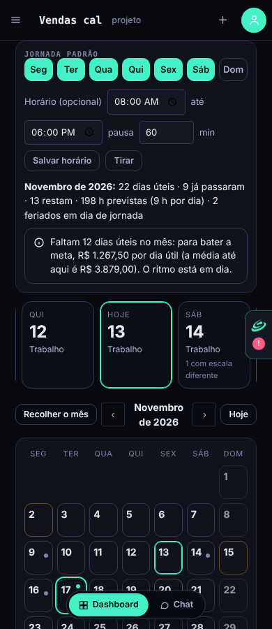
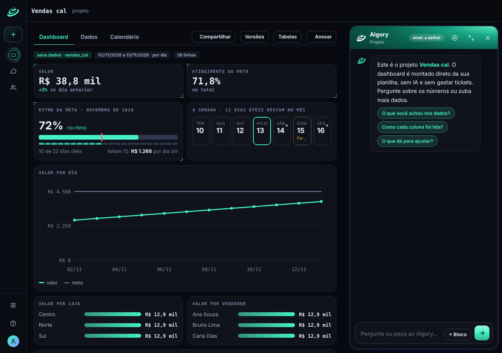
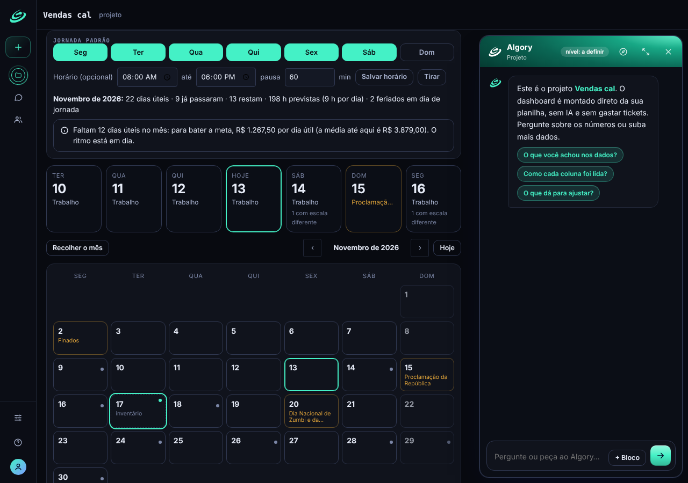
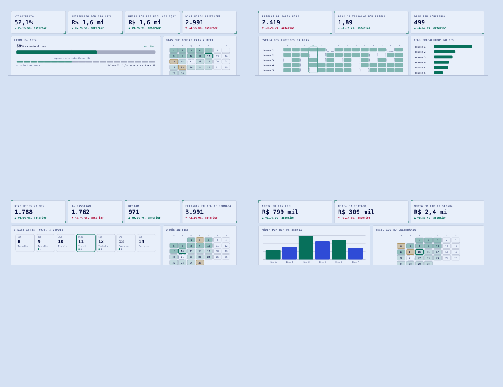

# Como usar

A ferramenta inteira, tela por tela. A ordem é a de importância: primeiro o que você usa todo dia, depois o que configura uma vez.

| # | Tela | Para quê |
|---|---|---|
| 1 | [Início e envio da planilha](#1-início-e-envio-da-planilha) | Entrar com os dados |
| 2 | [Tabelas](#2-tabelas-confirmar-a-leitura) | Confirmar o que o Algory entendeu |
| 3 | [Dashboard](#3-dashboard) | Ver o resultado |
| 4 | [Chat do projeto](#4-chat-do-projeto) | Perguntar e ajustar |
| 5 | [Planilha](#5-planilha) | Conferir a origem |
| 6 | [Associar](#6-associar) | Ligar uma tabela à outra |
| 7 | [Calendário](#7-calendário) | Jornada, folgas e feriados |
| 8 | [Compartilhar](#8-compartilhar) | Mandar o dashboard para alguém |
| 9 | [Versões](#9-versões) | Voltar atrás |
| 10 | [Repertório e Comunidade](#10-repertório-e-comunidade) | Modelos prontos |
| 11 | [Integrações](#11-integrações) | Google Planilhas, e-mail, chat, agenda |
| 12 | [Perfil, plano e código](#12-perfil-plano-e-código) | Conta, tickets, pagamento |
| 13 | [Ajustes, privacidade e ajuda](#13-ajustes-privacidade-e-ajuda) | O resto |

---

## 1. Início e envio da planilha

A tela inicial é uma conversa. Você pode escrever ou anexar um arquivo.

**O que entra:**

| Tipo | Observação |
|---|---|
| CSV, TSV, TXT | Separador e acentuação são detectados |
| XLSX, XLSM | As macros não são executadas |
| Foto de tabela | Lida por reconhecimento de texto, em português, inglês e espanhol |
| Google Planilhas | Por link publicado (tela de Integrações) |

**O que é recusado, com o motivo na tela:** executável, script, PDF, arquivo compactado, planilha com senha, nome com caminho de pasta, extensão dupla (`dados.csv.exe`) e arquivo cujo conteúdo não bate com a extensão. O servidor olha os primeiros bytes do arquivo, não confia no nome.

Não tem planilha? A tela oferece dados de exemplo.

Cada planilha vira um **projeto**. Um projeto pode ter várias tabelas.

## 2. Tabelas (confirmar a leitura)

Antes de montar qualquer coisa, o Algory mostra o que entendeu e espera você confirmar. O dashboard não é gerado antes disso.

O que ele faz sozinho:

- acha as tabelas dentro de uma aba bagunçada (título solto, linha em branco, duas tabelas lado a lado);
- separa anotações e metas que estão fora das tabelas;
- sugere o papel de cada coluna: data, valor, meta, categoria, chave;
- transforma meses que estão em colunas em linhas;
- lê as fórmulas e avisa quando uma aba puxa dado de outra;
- propõe arrumar categorias escritas de jeitos diferentes ("São Paulo", "SAO PAULO", "S. Paulo"). Você vê a proposta antes de aplicar.

O que ele tira, sempre, antes de gravar:

| Coluna | O que acontece |
|---|---|
| Nome de cliente, CPF, CNPJ, RG, e-mail, endereço | Removida |
| Telefone | Vira o estado do DDD |
| CEP | Vira estado, região e cidade |
| Vendedor, consultor, responsável | Vira um código por pessoa; só o dono do projeto vê o nome |

A tela diz quantas colunas saíram e por quê.

## 3. Dashboard

Montado por regra, sem IA. Abre na hora e não gasta ticket.

- **Indicadores** no topo, com a variação contra o período anterior. Se o mês ainda não acabou, a comparação é com os mesmos dias do mês anterior.
- **Evolução no tempo**, com o período que você escolher.
- **Rankings** por categoria (loja, produto, vendedor).
- **Prazos em dias úteis** entre duas datas (pedido e entrega, por exemplo).
- **Ritmo da meta:** quanto falta, quantos dias de trabalho restam e quanto precisa por dia. Usa o calendário do projeto.
- **A semana:** os próximos dias, com folgas, feriados e compromissos.

Filtros, período e ordenação mudam tudo na hora. Dá para trocar o modelo do dashboard, as cores, o fundo e o modo de apresentação (16:9), e exportar.

Nos planos pagos existe o cartão de imagem (logo, por exemplo). A imagem passa por verificação e fica só no seu navegador.

## 4. Chat do projeto

Fica ao lado do dashboard. Serve para duas coisas.

**Perguntar.** "Qual loja vendeu mais em outubro?", "Quanto a Ana vendeu?", "Compare este mês com o anterior". A resposta diz o que foi calculado, para você conferir se era isso mesmo. O caminho completo da pergunta está em [como a LLM trabalha](como-a-llm-trabalha.md).

Perguntas diretas são respondidas por regra, sem IA e sem gastar ticket: total, média, "por loja", "em outubro", "este mês", "top 3", "qual vendeu mais". O botão **Como foi calculado** mostra a consulta. Pergunte "quais métricas você conhece?" para ver a lista do projeto.

**Continuar a conversa.** Depois de uma resposta, dá para seguir sem repetir tudo: "e por produto?", "e em setembro?", "só do Norte", "compare com o mês anterior", "por que mudou?". Cada resposta já traz até três sugestões como botões. A memória fica no seu navegador por 30 minutos; o servidor não guarda a conversa.

**Comparar.** "Compare outubro com setembro", "faturamento este mês contra o mês passado". Mês incompleto é comparado com os mesmos dias do mês anterior.

**Investigar.** "Por que as vendas caíram?" ou "o que aconteceu com o custo do Sul?" compara dois períodos iguais, separa volume de valor médio e aponta a categoria que mais puxou a mudança. Mostra onde aconteceu, não inventa a causa.

**Ajustar.** Quase tudo que tem botão também funciona por frase, e a maior parte sem IA:

| Você escreve | O que acontece |
|---|---|
| "fundo escuro", "aumenta a grade" | Aplica na hora, com botão de desfazer |
| "tira o ranking de produtos", "top 5 por loja" | Mostra a proposta; você aprova e vira uma versão |
| "=receita / pedidos" | Calcula a fórmula com os seus dados e aponta erro |
| "modo apresentação" | Troca o layout |

O que gasta ticket é a pergunta que precisa de IA. A tela mostra o saldo, e análises pesadas avisam o custo antes.

**Quando os tickets acabam.** O chat não trava. Perguntas diretas seguem respondidas por regra. Se a pergunta precisar de IA, o Algory avisa que a IA chegou no limite, diz quando os tickets voltam e mostra botões com perguntas que funcionam sem ela, montadas com as métricas do seu projeto, além de dúvidas sobre o próprio Algory. Detalhes em [modo sem IA](tecnico/sem-ia.md).

## 5. Planilha

Mostra a planilha original, com as tabelas que o Algory encontrou destacadas. Serve para conferir de onde veio cada número.

Mostra até 200 linhas por vez. O arquivo guardado já está sem as colunas de identificação.

## 6. Associar

Para projetos com mais de uma tabela. Liga uma coluna de uma tabela à coluna correspondente de outra (o código do produto em Vendas e em Estoque, por exemplo).

- Colunas de mesmo nome e valores que batem são ligadas sozinhas, com o motivo registrado.
- Colunas de nomes diferentes com valores parecidos aparecem como sugestão, tracejadas.
- Ao abrir uma ligação, você vê quantos valores batem e o que existe só de um lado.

Duas vistas: as tabelas lado a lado ou no lugar real delas dentro da planilha.

## 7. Calendário

Diz ao Algory quando a empresa trabalha. Entra nos prazos em dias úteis, no ritmo da meta e na carga horária.

- **Jornada:** uma linha com os dias da semana. Marque os que são de trabalho.
- **Acesso rápido:** os 3 dias anteriores, hoje e os 3 seguintes, com o que tem em cada um.
- **Mês inteiro:** ao expandir, com feriados nacionais. Informando o CEP da empresa, entram os estaduais.
- **Marcação manual:** qualquer dia pode virar folga, dia de trabalho ou ter um compromisso.
- **Por pessoa:** se a planilha tem coluna de vendedor ou consultor, cada um pode ter folga fixa e escala.

A ordem de decisão de um dia: marcação manual, depois feriado, depois jornada. Detalhes em [calendário](tecnico/calendario.md).

## 8. Compartilhar

Gera um link só de leitura do dashboard.

| Opção | O que faz |
|---|---|
| Prazo | O link para de funcionar na data |
| Senha | Pede senha para abrir |
| Desligar | Corta o link na hora |
| Nível de privacidade | Como os nomes da equipe aparecem: abreviado ("Ana S."), só o primeiro nome, ou só o código (padrão) |
| Enviar por e-mail | Manda o link com um texto padrão |

Quem abre o link vê só os dados do dashboard. Não vê a planilha, as colunas nem quem é o dono. O link não aparece em buscador.

## 9. Versões

Cada ajuste aprovado no relatório vira uma versão. Dá para voltar a qualquer uma. Quantas ficam guardadas depende do plano.

## 10. Repertório e Comunidade

- **Repertório:** 76 modelos de dashboard e 28 cartões, por área (vendas, financeiro, estoque, equipe, calendário).
- **Comunidade:** modelos publicados por outros usuários. Só a estrutura é publicada, nunca os dados.

A busca entende sinônimo de negócio: "faturamento por filial" acha modelos de "receita por loja".

## 11. Integrações

| Integração | O que faz |
|---|---|
| Google Planilhas | Liga uma planilha publicada. O botão **Atualizar do Google** busca de novo; o intervalo depende do plano |
| PostgreSQL | Copia uma tabela ou visão do seu banco para um projeto (plano Médio em diante). Só leitura; a senha é usada uma vez e não fica guardada |
| Resumo por e-mail | Um resumo do projeto na sua caixa |
| Alertas em chat | Slack, Discord ou Google Chat, por webhook |
| Agenda | Um link de calendário (.ics) com os compromissos e folgas do projeto |

O que ainda não existe aparece como **Em breve**. Há um limite diário de envios por plano.

## 12. Perfil, plano e código

- **Segurança da conta:** verificação em duas etapas, por aplicativo ou e-mail.
- **Plano e pagamentos:** o plano atual, o saldo de tickets, o histórico e a recarga. Pagamento por PIX.
- **Resgatar código:** onde entra o código de convite ou de teste. A tela mostra o que o código libera antes de você confirmar. Passo a passo em [para quem vai testar](testers.md).
- **Uso:** quanto você gastou e em quê.

**O Algory está em beta.** Pode aparecer erro; quando aparecer, abra um chamado em Ajuda › Ajuda e chamados, que chega direto em mim. Não há mensalidade nem cobrança automática: o pagamento é por Pix, por 30 dias, e você só paga de novo se quiser. O que foi pago é honrado: pagou um mês, tem um mês; problema com pagamento se resolve por chamado ou em mail@osmio.tech. Para melhorar a ferramenta eu acompanho números de uso do sistema e da IA, não o conteúdo dos seus dados.

## 13. Ajustes, privacidade e ajuda

- **Ajustes:** aparência, idioma (português, inglês, espanhol) e avisos.
- **Privacidade:** o que é guardado e o que não é. Em **Sua conta e seus dados** você baixa tudo o que o Algory guarda (um .zip), encerra as sessões dos outros aparelhos e exclui a conta, com senha e confirmação.
- **Notificações:** o que mudou nos seus projetos.
- **Ajuda › Ajuda e chamados:** você abre um chamado (dúvida, problema, reclamação ou sugestão) e ele chega direto em mim. Com a conta aberta, a situação e a resposta de cada chamado aparecem ali mesmo, além do e-mail.

O Algory está em **beta**, e o selo na barra do topo avisa isso. Número estranho, arquivo que não sobe, resposta que não fez sentido: é exatamente o que eu preciso saber.
